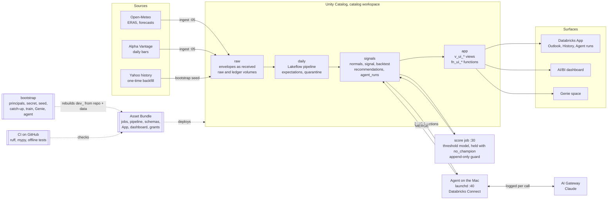

# weather-signal architecture

weather-signal reads US temperature and WMT prices, makes one deterministic buy, sell or hold call per hour, and has Claude explain each call and soften it to hold when an input looks wrong. Everything the signal reads lives in Unity Catalog on Databricks Free Edition; the one piece that runs off the workspace is the agent, which runs on a Mac.

## Walk through

**Sources.** Open-Meteo supplies ERA5 observed temperature and archived forecasts for 50 US metros. Alpha Vantage, the official keyed API, supplies the daily bars for WMT, SPY and XLP and drives the live hourly price. Yahoo is a one-time full-history backfill per ticker at catch-up, archived as received in bronze. Ingest lands each response once in `raw`, validated and as received. Medallion tiers: `raw` is bronze, `daily` silver, and `signals` plus `app` gold (the `v_ui_*` views and `fn_ui_*` functions the App, dashboard and Genie read). The names say what each layer holds; the tier is the Databricks convention.

**Time.** Each value carries `known_at`, the moment it became knowable. `asof.visible` is the one function that decides what a decision at a given `as_of` may see, so a backtest and a live call read the same way.

**Pipeline.** A Lakeflow pipeline builds `daily` with expectations. When a forecast column repeats its lead-0 values, that metro's rows go to a quarantine table and the signal holds; the pipeline doesn't halt.

**Score.** The `score` job runs at :30 and writes one signal row for today and each of the next six days. The model is deterministic and versioned per row, and the table is `appendOnly`. The live model is `stock_signal@champion`, which the train job registers only when the walk's gate passes. On dev the gate failed, no alias is set and every target holds as `no_champion` (claims.md rows 6e, 6i, 50c). The History backtest measures `threshold_wf` v2, the same threshold model refit each January (row 7). A guard reads each job-owned table's id, state and history before and after every score.

**Agent.** At :40 a launchd job on the owner's Mac opens a Databricks Connect session and waits until the guard has verified the hour. It then asks Claude through the AI Gateway, which logs each call in the workspace. Claude reads three UC functions and returns a rationale and, at most, a downgrade to hold. A `MERGE` sourced from the signal table writes the action, so the agent's code never names one. The Mac lets the agent use the owner's Claude subscription; the hour runs only while the Mac is on, and `docs/design.md` describes the hosted alternative.

**Surfaces.** The `app` schema holds `v_ui_*` views and `fn_ui_*` functions, which are all the App snapshot, the dashboard and the Genie space read (the App also reads a backtest view that Genie can't see). A job writes the App's snapshot at :15, and the App refuses one older than 75 minutes.

**Operating it.** One Databricks Asset Bundle declares jobs, pipeline, schemas, volumes, App, dashboard and grants. `bootstrap` creates what a bundle can't: principals, the secret, the seed, catch-up, the trained model, the Genie space and the LaunchAgent. A proof run destroyed every `dev_` schema, job, App and Genie space and rebuilt them with one bootstrap from the repository and the local data folder. CI runs lint, types and the offline tests with no secret and no workspace, and skips the agent's layers because its dependency is private.

## Not shown

The Mac is one host. A lost disk stops the agent until `agent install` runs again, and the agent's own logs sit outside workspace audit (`docs/design.md`, "Agent hosting").
